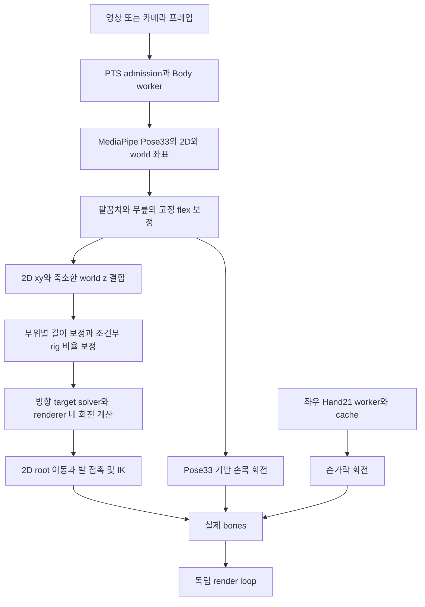
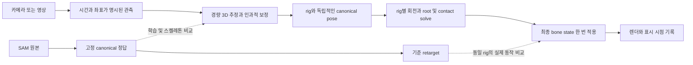

# SAM 정답 스켈레톤에 근접하는 실시간 추적·아바타 시스템: 코드 분석과 개선 설계

작성: 2026-09-08 KST · 분석 소스: `6cfc14996b73774ef34af0883937fb3f67dce68a`

후속 상태: 사용자 승인 후 R1 후보를 구현하고, 사용자가 제공한 `assets/videos`의 원본 7개 해시를 확인했다. 아래는 구현 전 분석 기록이다. 최신 구현 상태는 [실행 기록](/Users/chasoik/Projects/action-tracker/docs/2026-09-08-realtime-skeleton-implementation.md), 실제 detector/아바타·모델·해상도 비교와 수정된 작업 순서는 [원본 영상 후속 검증](/Users/chasoik/Projects/action-tracker/docs/2026-09-08-realtime-skeleton-video-validation.md)에 정리했다.

이 문서는 현재 코드에 대한 분석과 **제안 작업계획**이다. 구현을 실행하거나 기존 `GOAL_PLAN.md`를 활성화·변경하지 않았다. 사용자 요청대로 SAM 결과를 정답 스켈레톤으로 가정한다. SAM의 품질 재심사보다 실시간 입력과 최종 아바타 사이의 오차를 줄이는 데 초점을 둔다.

직접 계산한 데이터 현황과 SHA-256은 [분석 증거 JSON](/Users/chasoik/Projects/action-tracker/docs/2026-09-08-realtime-skeleton-avatar-evidence.json)에 있다. 아래에서 **확인**은 현재 소스·파일 또는 이번 소규모 재현, **과거 기록**은 저장된 문서의 측정값, **제안/가설**은 아직 실행하지 않은 개선을 뜻한다.

## 1. 권고하는 방향

가장 먼저 해야 할 일은 모델을 더 크게 만드는 것이 아니라, **추정한 3D 신체를 손실 없이 아바타에 전달하는 경로를 만드는 것**이다. 현재는 3D 좌표가 있어도 몸통·팔다리에 2D 기반 변형을 섞고, 손목과 손가락이 서로 다른 관절 의미를 사용하며, 루트와 발 접촉이 서로의 결과를 다시 바꾸는 구조다. 이 상태에서는 더 정확한 모델을 붙여도 개선된 정보가 최종 bone에 도달하지 않거나 다른 부위가 악화될 수 있다.

권고 순서는 다음과 같다.

1. 원본 영상과 기존 비교 경로를 복구하고 현재 소스를 기준선으로 고정한다.
2. 카메라 좌표·관절 의미·시간을 명시한 공통 3D 표현으로 전신과 손을 통합한다.
3. 그 표현으로 같은 아바타를 움직이는 독립적인 SAM 기준 동작을 만들고, 실제 적용 bone/FK까지 비교한다.
4. Hand21의 손바닥 정보가 실제 손목 회전을 소유하게 하고, 몸 전체의 관절·루트·접촉을 일관되게 계산한다.
5. 남은 추정 오차에 대해 현재 MediaPipe, Heavy 옵션, SAM으로 학습한 작은 인과적 보정 모델, 별도 whole-body 모델을 같은 조건에서 비교한다.
6. 파일 재생을 늦추지 않는 실행과 실제 카메라에서 처리율·움직임 지연·최종 동작을 함께 확인한다.

단기적으로는 현재 MediaPipe 기반 런타임을 재사용하는 편이 합리적이다. 중기적으로는 **SAM → 경량 모델 학습 → 공통 스켈레톤 → rig별 retarget**이 유망하다. 다만 현재 7개 영상만으로 새로운 범용 영상 인코더를 학습하거나 SAM 수준의 가림 복원을 보장할 수는 없다. 우선 표현과 리타게팅 손실을 제거한 뒤, 실제 남는 오차에 필요한 모델 용량을 선택해야 한다.

## 2. 현재 확보된 증거와 한계

### 2.1 데이터 현황

현재 `output/`와 `output/test-videos/`는 존재하지 않는다. 원본 영상 7개의 경로·크기·해시는 추적 중인 [source inventory](/Users/chasoik/Projects/action-tracker/tests/fixtures/sam-goal-v2/labels/source-inventory.json)에 남아 있다. 아래 FPS·길이·영상 해상도는 그 inventory와 SAM summary에서 읽은 값이며, 원본 영상 바이트를 다시 검증한 결과는 아니다.

| clip | FPS | SAM 행 수 | person이 있는 행 | 특이 사항 |
|---|---:|---:|---:|---|
| arms-crossed | 30 | 386 | 349 | 37행은 persons가 비어 있음; SAM 시각이 source PTS보다 33.333ms 작음 |
| csi-pose | 30 | 2,849 | 2,849 | summary의 detection_misses=163이지만 JSONL의 person 누락은 0 |
| dance-16x9-padded | 약 23.920 | 359 | 359 | 3414×1920 입력 |
| jujae-regression-0-16_5 | 약 59.940 | 990 | 990 | 1080×1920 입력 |
| shorts-keGbIts0CA0-16x9-padded | 60 | 1,237 | 1,237 | 3414×1920 입력 |
| shorts-new-dance-E9_h_ZW5z0U-16x9-padded | 30 | 439 | 439 | 3414×1920 입력 |
| shorts-vc0GDveRIp0-16x9-padded | 30 | 451 | 451 | 한 행에는 person이 2명 있음 |
| 합계 | — | **6,711** | **6,674** | source inventory 기준 총 약 189.64초 |

이번에 6,711행 전체를 읽었다. 저장된 MHR70 3D 좌표의 비유한 값과 비단조 SAM 시각은 발견되지 않았다. 모든 person 레코드에 `focal_length`, `pred_cam_t`, `global_rot`, 127개 `mhr_joint_coords_127_3d`도 있다. 다만 이것이 모든 관절의 local rotation이 저장되어 있다는 뜻은 아니다.

개발용 기존 4 clips는 2,486행, 약 65.29초다. 연속 프레임끼리 매우 유사하므로 이를 독립적인 학습 샘플 수천 개로 해석하면 안 된다. challenge 3 clips의 구조·누락·시각은 이번에 확인했지만, 새 모델을 맞추거나 영상별 오차를 측정하지 않았다.

`csi-pose`의 detector miss 카운터가 무엇을 의미하는지는 추출 코드 없이는 확정할 수 없다. summary의 miss 수를 곧바로 정답 부재로 변환하면 잘못된 평가 분모를 만든다. VC의 복수 person 행도 단순 배열 순서가 추적 대상의 정체성을 보장하지 않는다.

### 2.2 이미 구현된 것을 다시 제안하지 않아야 한다

현재 코드는 초기 README보다 많이 발전했다.

- Body와 Hand worker는 기본 활성이다. [runtime options](/Users/chasoik/Projects/action-tracker/src/tracking-runtime-options.js:3)
- Body는 기본 Pose Full, GPU 우선이며 Hand와 Face는 CPU를 우선한다. Hand는 좌우 별도 worker, IMAGE 모드 ROI 추론이다. [설정](/Users/chasoik/Projects/action-tracker/src/app.js:130), [hand worker](/Users/chasoik/Projects/action-tracker/src/hand-worker.js:20)
- Body worker는 현재 ImageBitmap을 `detectForVideo`에 직접 넣는다. README에 남은 ImageData readback 설명을 현재 병목으로 취급하면 안 된다. [실제 추론](/Users/chasoik/Projects/action-tracker/src/motion-worker.js:469)
- Body 30Hz admission, pending frame 교체, stale 결과 차단, generation reset과 사전 초기화된 detector pool이 있다.
- 실제 bone의 local quaternion, root transform, model-local/world FK endpoint를 수집한다. [실제 상태 수집](/Users/chasoik/Projects/action-tracker/src/avatar-renderer.js:1424)
- rig의 rest basis, causal quaternion, 손가락 flex, 발 접촉 FSM과 two-bone IK도 존재한다.

따라서 “worker를 넣자”, “IK를 추가하자”, “실제 bone을 측정하자”만으로는 새로운 개선안이 되지 않는다. **기존 기능의 연결 방식과 최적화 대상을 바꿔야 한다.**

### 2.3 기존 성과와 남은 오차

다음은 [GOAL_PLAN의 7월 17~18일 기록](/Users/chasoik/Projects/action-tracker/GOAL_PLAN.md:843)이다. 관련 `output` 원본이 없어 이번에 재계산하지 못했다.

| 과거 시도 | 기록된 결과 | 이번 설계에 주는 의미 |
|---|---|---|
| 팔 방향 residual student | Arm/ForeArm P95 61.653→57.863°, wrist FK P95 24.764→25.805%H | 방향 loss만 줄여도 endpoint는 악화될 수 있음 |
| strict arm hold/decay 활성화 | ForeArm P95 63.042→64.011°, 일부 root/contact도 악화 | 기존 필터를 다시 켜는 것만으로 가림 복원이 해결되지 않음 |
| Pose 손목 secondary 부호 보정 | Hand P95 119.822→121.462° | 부호·threshold 보정만으로 관절 의미 차이를 해결하기 어려움 |
| RTMW3D-X 8Hz anchor | Body 약 30Hz, Hand P95 119.822→120.160°, 접촉 candidate/planted/IK 29/26/26→12/1/1 | 추론 성공·속도 확보와 실제 아바타 개선은 별개 |

이는 현재 성능의 새 측정값이 아니다. 다만 실제 코드에 남아 있는 손목 소유권·루트 접촉 결합과 맞물리는 실패 이력이므로, 같은 접근의 반복보다 구조 변경을 우선할 근거가 된다. 문서 표의 P0~P3 “완료”도 최종 제품 정확도 달성을 뜻하지 않는다.

## 3. 현재 경로와 근본적인 문제

현재 기본 경로를 축약하면 다음과 같다.



### F1. 3D 좌표가 있어도 전신을 일관된 3D 공간에서 풀지 않는다 — 최우선

**확인.** renderer의 `landmarkToVector`는 다음과 같다.

```text
x = 2 × (image_normalized_x - 0.5)
y = 2 × (0.5 - image_normalized_y)
z = -(world_z - center_z) × worldToScreenScale × depthScale
기본 depthScale = 0.45
```

[xy 변환](/Users/chasoik/Projects/action-tracker/src/avatar-renderer.js:7513), [깊이 변환](/Users/chasoik/Projects/action-tracker/src/avatar-renderer.js:7573). MediaPipe의 image x/y는 각각 영상 너비/높이로 정규화되고 world xyz는 hip 중심의 미터 단위 추정 좌표다. 서로 다른 표현이다. [MediaPipe 공식 좌표 설명](https://developers.google.com/edge/mediapipe/solutions/vision/pose_landmarker/web_js)

너비와 높이가 다른데도 정규화된 x/y를 같은 단위처럼 사용한다. 이번에 현재 함수 본문을 읽어 xy 부분을 격리 실행했다. depth를 0으로 고정하고 픽셀에서 dx=dy=100인 방향을 넣으면 다음 결과가 나온다.

| 입력 | 원래 픽셀 방향 | 현재 함수 결과 |
|---|---:|---:|
| 1920×1080 | 45° | 60.642246° |
| 720×1280 | 45° | 29.357754° |

이는 함수의 종횡비 의존성을 확인한 재현이다. 실제 영상의 최종 bone 오차를 측정한 수치는 아니다. 팔 길이 보정도 현재 `rawPoints`의 방향을 보존하므로 이 왜곡을 일반적으로 제거하지 못한다. `worldLandmarks`가 finite인지 확인하지만 정규화에 넣는 벡터는 hybrid `rawShoulder/rawElbow/rawWrist`다. [팔 보정 경로](/Users/chasoik/Projects/action-tracker/src/avatar-renderer.js:6784)

깊이 0.45도 일반적인 신뢰도 조절이 아니라 기하 변형이다. 예를 들어 x와 z의 크기가 같은 45° 벡터에서 z만 0.45배 하면 각도는 24.228°다. 이 예는 기본 정책의 효과를 설명하는 계산이며 dynamic 보정 이후 모든 관절이 같은 오차를 갖는다는 주장은 아니다.

**영향.** padding·화면 비율·카메라 방향에 따라 같은 3D 동작이 다른 target이 될 수 있다. 길이를 맞추더라도 방향과 depth 부호가 틀리면 SAM과의 차이는 남는다. 화면 overlay가 맞는 것과 신체 운동이 맞는 것이 분리된다.

**개선.** 원본 2D는 픽셀 관측으로 보존하고, body pose는 단일 카메라 3D 좌표에서 계산한다. 2D는 투영 오차를 줄이는 관측식으로 결합한다. world가 없는 fallback은 별도 2D 관측 모드로 표시하며, 약한 depth를 숫자상 “정확한 3D”로 승격하지 않는다.

### F2. canonical adapter가 관절 의미 변환과 경험적 보정을 함께 수행한다

**확인.** [canonical adapter](/Users/chasoik/Projects/action-tracker/src/canonical-skeleton-adapter.js:6)는 팔꿈치 16°, 무릎 11° flex bias와 0.75/0.25 이동 분배를 사용한다. 보정된 world 좌표를 image 쪽에 되돌리는 작업은 팔꿈치 관절에만 적용한다. [projection 범위](/Users/chasoik/Projects/action-tracker/src/canonical-skeleton-adapter.js:52)

이 보정이 일부 development 영상에 유효했을 수 있다. 그러나 관절 중심의 위치 차이가 모든 사람·카메라·자세에서 같은 각도 bias라는 보장은 없다. 보정된 image 좌표를 raw 검출 관측처럼 다시 사용하면 추정 오차와 보정 오차의 원인도 흐려진다.

**개선.** `raw observation → 의미·좌표 adapter → pose estimator/refiner`를 구분한다. adapter는 인덱스·단위·좌표계·관절 의미를 명시하고 raw 값을 보존한다. 16°/11° 정책은 별도 residual 후보로 격리해 0-bias·현재 bias·학습 residual을 비교한다. 처음부터 삭제하는 것이 아니라 공통 좌표에서 기여를 재측정한다.

### F3. 독립적인 “정확한 스켈레톤 산출물”이 아직 제품의 중심이 아니다

**확인.** [motionFrame](/Users/chasoik/Projects/action-tracker/src/motion-frame.js:25)은 MediaPipe 형태의 관측 배열이며, [pose solver](/Users/chasoik/Projects/action-tracker/src/solver/pose-solver.js:201)는 `rotations: {}`와 방향 target을 반환한다. strict frame의 [localRotation도 deferred](/Users/chasoik/Projects/action-tracker/src/retarget/skeleton-fk-retarget.js:47)이다. 실제 회전·가림 상태·root·손목·접촉 계산은 renderer가 마무리한다.

또한 pure solver의 [buildPosePoints](/Users/chasoik/Projects/action-tracker/src/solver/pose-solver.js:526)는 world 좌표를 우선 사용하지만, 제품 renderer는 F1의 hybrid 경로를 사용한다. 조건부 [avatar proportion 보정](/Users/chasoik/Projects/action-tracker/src/avatar-renderer.js:4678)은 pose solver 전에 사람 좌표를 rig 비율로 바꾼다. 같은 관측이 어떤 rig를 골랐는지에 따라 추정 단계에서 달라질 수 있다.

**영향.** “스켈레톤은 정확한데 retarget이 틀린가”를 분리하기 어렵다. pure solver 평가 통과가 실제 제품의 같은 계산을 입증하지 않는다. 10,238행의 app과 8,125행의 renderer에 계산 상태가 집중된 것도 이 결합의 결과다. 파일 크기 자체보다 **관측·추정·rig·측정의 경계가 겹친 것**이 문제다.

**개선.** 아바타를 로드하지 않아도 얻을 수 있는 canonical pose를 먼저 산출한다. 이 단계는 사람의 관절 위치·의미상 회전·신뢰 상태·루트 관측을 소유한다. rig 비율과 실제 bone quaternion은 그다음 pure retarget 단계에서 처리한다. renderer는 완성된 상태를 한 번 적용한다.

### F4. 정밀한 손 입력이 실제 손목을 움직이지 못한다 — 최우선

**확인.** [applyPoseOwnedHandOrientations](/Users/chasoik/Projects/action-tracker/src/avatar-renderer.js:4869)는 strict 모드의 손목 회전을 Pose33 wrist/index/pinky로 계산하고 owner를 `pose-world-causal`로 고정한다. Hand21의 palm basis는 계산되지만 [손목에 적용하는 조건](/Users/chasoik/Projects/action-tracker/src/avatar-renderer.js:5696)은 strict가 아닐 때뿐이다. Pose 손목이 없으면 strict 경로는 Hand21으로 회복하는 대신 [relax](/Users/chasoik/Projects/action-tracker/src/avatar-renderer.js:5134)한다.

teacher를 MP33으로 변환할 때 index/pinky 대표점에는 Hand21 mapping의 MCP 위치가 들어간다. [MHR70→MP33](/Users/chasoik/Projects/action-tracker/src/skeleton/mhr70-mapping.js:77), [Hand21 mapping](/Users/chasoik/Projects/action-tracker/src/skeleton/mhr70-hands.js:4). Pose33의 손끝 대표점과 손바닥 MCP는 같은 관절이 아니다. 손가락 굽힘이 손바닥 전체 회전으로 해석될 수 있다. 이는 기존 실패 로그의 Pose fingertip↔MHR MCP 문제와도 일치한다.

**개선.** 좌우 손마다 단일 wrist orientation owner를 만들되 입력을 고정하지 않는다. 신뢰할 수 있고 현재 시각에 운반된 Hand21의 MCP 평면을 주 관측으로 쓰고, Pose33은 가림 시 약한 보조 관측으로 쓴다. wrist와 finger를 같은 hand pose에서 풀어 전달한다. 모델 변경 전 이 소유권부터 해결한다.

단순히 Hand21 절대 회전을 복사하는 패치는 충분하지 않다. Body/Hand의 원점·crop 축·mirror·관측 시각이 다르므로 같은 공간과 시간으로 옮겨야 한다. Hand world의 원점은 손의 geometric center다. wrist를 뺀 상대 관절과 crop 회전을 사용해 body wrist에 붙인다. [Hand Landmarker 공식 결과 설명](https://developers.google.com/edge/mediapipe/solutions/vision/hand_landmarker/web_js)

### F5. 몸의 앞뒤 이동과 발 접촉이 일관된 root 상태로 풀리지 않는다 — 최우선

**확인.** [applyRootMotion](/Users/chasoik/Projects/action-tracker/src/avatar-renderer.js:4553)은 2D 몸 중심의 변화를 x/y 이동으로 환산하고 target z를 항상 0으로 둔다. 몸의 scale을 초기화하지만 실제 전후 root translation으로 추정하지 않는다. IK가 z를 일시 보정할 수 있어도 사람의 전후 이동을 추정한 것은 아니다.

[접촉 계산](/Users/chasoik/Projects/action-tracker/src/avatar-renderer.js:3239)은 현재 root/rig에서 예측한 ankle과 그 프레임의 최소 ankle y를 바탕으로 FSM을 갱신한다. 이후 [root reach correction](/Users/chasoik/Projects/action-tracker/src/avatar-renderer.js:3420)이 `model.position`과 `rootMotion.offset`에 보정량을 누적한다. 다음 프레임의 2D root 보간은 같은 offset을 다시 움직인다. 좌→우 순차 보정이므로 먼저 처리한 발의 보정이 다음 발의 입력을 바꾼다.

**영향.** root yaw나 팔·몸통 관측을 개선해도 world ankle이 바뀌며 contact 상태가 달라질 수 있다. 프레임마다 가장 낮은 발을 바닥 근거로 쓰면 점프·발끝 서기·가림에서 구별이 어렵다. 자기 출력의 변화가 다음 접촉 판단으로 돌아오므로 부분 보정의 효과가 국소적이지 않다.

**개선.** root의 관측 상태와 rig 제약에 의한 보정 상태를 분리하되, 이를 단순 offset 분리 패치로 끝내지 않는다. 관측 기반 contact 확률, 유지되는 floor 상태, 양발 제약, root 이동을 같은 bounded solve에서 처리한다. 최종 root와 다리 회전을 원자적으로 한 번 commit한다. 두 발이 닿았을 때는 양쪽을 함께 최적화하고, 불가능한 anchor는 낮은 신뢰 쪽부터 완화한다.

### F6. 정답을 기존 MP33 경로로 축소하는 과정에서도 정보가 사라진다

**확인.** [HMR adapter](/Users/chasoik/Projects/action-tracker/scripts/hmr-jsonl-adapter.mjs:285)는 70개 관절을 MP33과 선택적 Hand21로 바꾼다. hip 중심화 이후 camera translation·global rotation·127개 joints는 motionFrame에 보존하지 않는다. 추가 elbow 표면점·acromion·neck도 주 body 경로에서 대부분 쓰이지 않는다. 시야 밖 2D 좌표를 clamp하고 visibility를 낮추는 정책도 있다.

따라서 현재 teacher 아바타는 “원래 SAM 동작” 전체라기보다, **SAM을 현재 표현으로 축소한 뒤 현재 정책으로 해석한 결과**일 수 있다. teacher와 live가 똑같이 틀리면 두 아바타의 차이가 작아지는 공통 오차도 생긴다.

**개선.** SAM 원본에서 canonical 기준 pose를 직접 구성한다. 2D/3D 원본, 관절 의미, camera 항목은 보존한다. 127 joints의 이름·hierarchy·단위는 현재 export에 충분히 명시되지 않았으므로 먼저 exporter/공식 모델 정의와 대응시킨다. 이름 없는 127개 배열을 추측해서 사용하지 않는다. SAM은 MHR 기반 body/hand/feet 모델이다. [공식 저장소](https://github.com/facebookresearch/sam-3d-body)

추가 teacher 재추론 없이 지금의 70/127 좌표로 활용 가능한 정보를 우선 사용한다. 위치만으로 결정되지 않는 bone twist는 명시적 prior로 표시한다. 이를 “SAM이 제공한 정확한 local rotation”이라고 부르지 않는다.

### F7. 필터의 부드러움과 실제 동작 지연이 혼동될 수 있다

**확인.** strict 제품 경로는 [targetStabilization을 끈 solver](/Users/chasoik/Projects/action-tracker/src/avatar-renderer.js:3030)를 다시 호출하고, 팔의 actual local quaternion에는 별도로 420°/s 제한을 적용한다. 이번에 [실제 limiter](/Users/chasoik/Projects/action-tracker/src/retarget/rig-local-rotation.js:27)를 호출했을 때 30Hz의 90° 목표 변화는 한 프레임에 14°만 적용됐다.

이미 초기화된 상태에서 90°를 따라잡는 데 필요한 이론적 최소 시간은 약 214ms이며, 30Hz 이산 적용에서는 약 7 frame이다. 이는 그 순간 코드 실행이 25ms 안에 끝나는 것과 양립한다. 즉 capture→apply 지연이 낮아도 표시된 포즈가 입력 동작을 늦게 따라갈 수 있다.

**개선.** 관절별 confidence·관측 속도·잔차에 적응하는 인과적 상태 추정을 한 곳에 둔다. 물리적으로 정상인 빠른 춤과 모델의 잘못된 jump를 구별하는 데 teacher 기반 residual·속도 오차를 사용한다. 고정 cap을 무조건 키우거나 기존 hold를 통째로 켜는 실험은 반복하지 않는다. 처리 지연과 signal 지연을 별도 보고한다.

### F8. 비동기 body/hand/face를 한 프레임처럼 취급하기 쉽다

**확인.** Body 예산은 30Hz, Hand 기본 간격은 50ms, Face는 10Hz다. Hand cache 최대 age는 500ms이며 face에는 maturation delay가 있다. [cadence](/Users/chasoik/Projects/action-tracker/src/tracking-cadence.js:1), [cache 설정](/Users/chasoik/Projects/action-tracker/src/app.js:133)

현재 source PTS와 held/predicted metadata가 이미 있으므로 비인과성이라고 단정할 수는 없다. 다만 Body의 최신 프레임에 붙은 Hand가 최신 검출이라는 뜻은 아니다. 오래된 손가락을 현재 wrist에 붙이는 것과 현재 시각의 손 관절을 관측한 것은 다르다.

**개선.** 각 채널의 observation PTS·age·observed/held/predicted를 canonical state까지 유지한다. 현재 body 시각으로 운반한 손목 basis와 finger local articulation을 분리하고, 재사용한 관측을 새 측정으로 filter에 중복 투입하지 않는다. 관측된 coverage와 표시되는 coverage를 따로 센다.

### F9. 파일 영상의 재생 제어는 카메라 실시간 증거를 대신하지 못한다

**확인.** [video playback backpressure](/Users/chasoik/Projects/action-tracker/src/video-playback-backpressure.js:63)는 file-video Body backlog가 생기면 재생을 일시 정지한다. 이는 파일의 coverage를 보존하는 기능이며 실제 카메라에는 적용할 수 없다.

현재 detection FPS는 callback 시각 간격을 기반으로 계산하므로 이를 단순히 “PTS로 계산한 가짜 FPS”라고 볼 근거는 없다. 그러나 그것만으로 1배속 지속 재생을 입증하지도 못한다. wall time·재생 정지 시간·초기화 비용·source progress를 함께 봐야 한다. [현재 FPS 계산](/Users/chasoik/Projects/action-tracker/src/app.js:6867)

**개선.** 정확도 분석용 frame-by-frame 재생과 제품용 1배속 재생을 명확히 분리한다. 제품 성능 모드에서는 backpressure로 source를 정지시키지 않는다. 부하가 넘으면 오래된 대기 프레임을 버리고, 고정된 계획에 따른 cadence만 적용한다. 영상 duration/wall elapsed와 `totalHoldMs`를 함께 측정한다.

captureTime이 없는 경우 현재 코드도 receive/callback 시각을 사용한다. 이 경우 “센서 노출부터 디스플레이까지 80ms”라고 확대 해석하지 않는다. [시각 출처](/Users/chasoik/Projects/action-tracker/src/app.js:5394)

### F10. 정확도 평가 경로와 실제 제품 경로 사이에 빈틈이 있다

**확인.** 일반 [compareRecordings](/Users/chasoik/Projects/action-tracker/scripts/motion-recording-compare.mjs:169)는 pure `solvePoseFrame`으로 비교하며 default timestamp tolerance가 50ms다. offset 자동 탐색도 선택적으로 지원한다. CLI의 `passed`는 페어가 있다는 실행 성공 표시이고, SAM 동작 정확도 통과와 같지 않다.

현대화된 실제 bone telemetry는 이미 있지만, 이 일반 비교기를 최종 avatar 평가기로 그대로 사용할 수 없다. 방향·길이 일관성·MediaPipe 대비 agreement 점수는 서로 다른 의미다. 길이 보정이 자신의 길이 일관성 점수를 높이는 것도 GT 정확도 향상의 증거가 아니다.

또한 실제 bone snapshot은 update 직후이고 render loop는 이후 별도로 실행된다. VRM runtime 갱신도 render 직전에 있다. 모든 VRM에서 snapshot과 표시 bone이 다르다고 확인한 것은 아니지만, 최종 claim에는 표시 직전 상태 및 보이는 움직임 확인이 필요하다. [render loop](/Users/chasoik/Projects/action-tracker/src/avatar-renderer.js:6520)

**개선.** 공통 canonical pose를 저장하고 같은 함수로 offline 비교한다. actual-state 비교는 동일 RigProfile과 source key로 수행한다. 기존 telemetry/runner를 재사용하고 부족한 비교 함수만 추적 가능한 `scripts`에 둔다. source 근사 페어링·자동 offset은 진단으로만 남기고 최종 점수에는 사용하지 않는다.

### F11. 데이터와 과거 실패의 해석도 개선해야 한다

**확인.** arms-crossed의 raw `timestamp_sec`와 exact manifest는 모든 frame에서 1/30초 차이가 난다. HMR adapter는 raw timestamp를 그대로 사용한다. 반면 기존 목표는 exact PTS를 요구한다. 이는 **원본 timestamp 기반 일반 adapter의 정렬 위험**이며, 과거 exact runner의 모든 결과가 틀렸다는 판정은 아니다.

**개선.** teacher `frame_index`와 source `sourceFrameIndex`로 대응시킨 후 manifest PTS를 부여한다. 이 33.333ms는 성능을 좋게 만들기 위해 찾는 offset이 아니라 데이터에 기록된 origin 차이다. 양쪽에 같은 규칙을 고정 적용한다. persons가 없는 37행도 timeline에서는 보존한다.

과거 로그에는 contact 횟수 감소나 fresh/fixed 비교 차이로 후보를 기각한 사례가 있다. 접촉 횟수의 동일성은 알고리즘 구조 변경의 최종 품질 목표가 될 수 없다. 실제 접지 구간의 slide, 발 들기 오검출, endpoint 오차를 유지해야 한다. **기존 실패를 성공으로 바꾸지는 않고**, 이후 구조 실험의 평가를 실행 전에 합의·고정하는 제안이다.

### F12. 관절 위치로 관측하지 못하는 회전과 척추 곡률을 휴리스틱으로 채운다

뼈의 양 끝점으로는 뼈가 향하는 방향을 알 수 있지만 그 축을 중심으로 한 twist는 결정되지 않는다. 팔이 거의 펴지면 세 관절로 만든 평면도 불안정해진다. shoulder/hip만으로 실제 척추의 여러 분절 곡률을 모두 복원할 수도 없다. secondary axis와 spine 분배는 필요한 prior지만 관측된 사실과 구별해야 한다.

**추가 확인.** 현재 spine wave 계산은 torso 방향에 수직이 되도록 left 축을 만든 뒤 `dot(torsoVector, left)`로 sideRatio를 계산한다. 정상적인 비퇴화 조건에서는 이 값이 구조적으로 0이다. [pure solver](/Users/chasoik/Projects/action-tracker/src/solver/pose-solver.js:588), [renderer의 같은 계산](/Users/chasoik/Projects/action-tracker/src/avatar-renderer.js:6924). hip 중심 (0,0,0), shoulder 중심 (0.4,1,0)인 합성 입력으로 실제 `buildPosePoints`를 호출해 sideRatio/sideOffset=0을 확인했다. 몸통의 전체 기울기는 직선 spine에 반영되지만, 이 추가 side-wave 경로는 그 기울기로부터 곡률을 생성하지 못한다.

**개선.** torso와 함께 기울어지는 축이 아니라 pelvis 기준 축에 대한 상대 변형을 사용하고, SAM의 사용 가능한 관절·회전 정보로 분절별 목표를 구성한다. 관측되지 않는 twist와 곡률은 learned prior 또는 명시적 분배 정책으로 표현한다. gain을 조정하기 전에 해당 입력 신호가 실제로 변하는지부터 확인한다. 이 수정도 spine 표현 변경과 최종 endpoint 변화를 함께 비교해야 한다.

## 4. 제안 아키텍처



SAM 파일은 개발·학습·평가 경로에만 존재한다. 제품 실행은 현재와 과거의 카메라/영상 관측만 읽는다. 영상 파일 이름·clip ID·정답 pose를 런타임 보정의 lookup key로 사용하지 않는다.

### 4.1 최소 데이터 계약

새 외부 플랫폼 대신 다음 내부 경계를 만든다. 기존 motion recording v1은 adapter로 계속 읽을 수 있게 한다.

| 산출물 | 필수 내용 | 소유하는 계산 |
|---|---|---|
| ObservationFrame | generation, source frame/PTS, receive/capture 시각, image size, crop affine, pixel 2D, 원래 3D, 각 관측의 score·age·semantic ID | 검출과 좌표 복원 |
| CanonicalPose | root-relative 3D joints, semantic local rotations, 관측 가능한 회전 축, bone lengths, root estimate, contact evidence, 관절별 상태 | 인체 추정과 인과적 상태 |
| RigPose | RigProfile ID, 최종 local quaternions, root transform, 접촉 보정, 적용 원인 | rig 비율·축과 제약 해결 |
| AppliedPose | 실제 적용 quaternion/FK, source key, apply/render 시각, 화면에 사용된 state ID | 결과 관측 |

world 좌표의 실제 단위가 확인되지 않은 입력은 unit-unknown으로 표시한다. 의미상 rotation과 rig-local quaternion도 같은 필드에 넣지 않는다. `valid`, `observed`, `held`, `predicted`, `lost`를 분리하고, 없는 정보를 zero vector나 confidence=1로 조용히 채우지 않는다.

### 4.2 좌표계와 관절 의미

body 추정은 카메라 3D 공간에서 수행한다. 예를 들어 OpenCV식 +x 오른쪽/+y 아래/+z 전방 입력은 canonical rendering 공간으로 한 번만 변환한다. 실제 모델의 축 규약은 명시적으로 검증하고 변환행렬에 기록한다. glTF는 오른손 좌표계와 +Y up을 사용하지만, 각 avatar의 rest bone 축은 별도다. [glTF 규격](https://registry.khronos.org/glTF/specs/2.0/glTF-2.0.html)

- image x/y는 원래 픽셀 또는 명시적인 camera-normalized 좌표로 보관한다. 정사각형 임의 공간을 물리 공간으로 취급하지 않는다.
- body world joints는 동일한 축과 scale로 묶는다. 깊이 신뢰도가 낮으면 관측 가중치나 covariance를 조절하고 z만 축소하지 않는다.
- crop/resize/padding의 역변환을 보존한다. UI의 거울 보기와 신체 좌우 의미를 분리한다.
- canonical 관절은 의미 있는 body joint centers, wrist, MCP/IP, heel/toe를 식별한다. 검출기가 제공하지 않는 관절은 추정치 또는 unavailable로 표시한다.
- bone 길이는 사람 기준으로 천천히 추정한다. avatar의 길이로 사람 스켈레톤을 먼저 바꾸지 않는다.
- 새 모듈은 x/y/z 단위, left/right, parent-child, pelvis 원점을 작은 비대칭 3D 사례로 검증한다. 정면 T-pose 하나로 축을 확정하지 않는다.

### 4.3 손목·손가락을 같은 관측 모델로 통합

한 손의 기본 basis는 wrist→middle MCP 방향과 index MCP·pinky MCP 평면으로 만든다. 손끝 굽힘을 손바닥 방향으로 사용하지 않는다. Hand21 관측은 wrist 기준으로 중심화하고 crop 회전·거울 변환을 복원한 뒤 body 공간과 맞춘다.

Body 시각 t보다 오래된 손 관측 s는 두 부분으로 처리한다. 손가락의 palm-local articulation은 자체 상태로 유지하고, wrist orientation은 body의 변화와 유효한 손 관측으로 t까지 예측한다. 오래된 관측을 현재 시각의 새 관측처럼 다시 업데이트하지 않는다. future 관측은 사용하지 않는다.

소유권은 한 모듈만 갖는다. 해당 모듈이 Hand21, Pose 보조, 이전 상태를 선택·융합하고 하나의 최종 결과를 낸다. 먼저 현재 Hand21 경로만으로 효과를 확인한 후 RTMW 등 새 입력을 붙인다. Hand 전용 fixed replay 실험에서 root/lower body가 바뀌면 모델 정확도를 논하기 전에 데이터 재생·공유 상태 결합을 조사한다.

### 4.4 관절·루트·접촉을 함께 계산

권고 상태는 root transform T, 관절 회전 q, 사람 길이 l, 속도 v, floor와 좌우 접촉 확률 c다. 다음 목적함수를 작은 제한된 반복으로 푸는 방식을 후보로 삼는다.

```text
J = λ3D · 관측 3D와 FK 관절의 robust 거리
  + λ2D · 카메라 투영과 원본 2D의 robust 거리
  + λR  · 관측 가능한 bone 방향/회전 차이
  + λT  · 과거 상태에서 예측한 움직임과의 차이
  + λC  · 접촉 확률로 가중한 발의 anchor 거리
  + λL  · 관절 한계와 길이 일관성 제약
```

이것은 구현 제안이다. JS의 소규모 Gauss–Newton, EKF 형태의 상태 업데이트와 analytic IK 조합 중 실제 budget을 충족하는 쪽을 선택한다. 처음부터 큰 전신 물리 시뮬레이터를 만들지 않는다. 직전 해로 초기화하고 반복 수를 제한한다. 정답 joint 오차가 줄지 않는 “물리적으로 부드러운” 출력은 채택하지 않는다.

루트 관측과 contact 보정을 별도 변수로 유지하고 최종 T에 합성한다. floor는 신뢰 가능한 과거 접촉 관측으로 유지하며 프레임마다 최저 ankle로 재설정하지 않는다. heel/toe 접촉과 ankle endpoint를 구별한다. 발목은 실제 발바닥 접점이 아니다.

두 발 접촉은 함께 평가한다. 양쪽 anchor가 인체 길이·현재 관측과 양립하지 않으면 신뢰가 낮은 제약을 부드럽게 해제한다. root/다리/발을 확정한 뒤 다른 함수가 다시 수정하지 않는다. 카메라가 움직인 경우는 사람의 전후 이동과 분리 관측이 필요하므로, 우선 고정 카메라 지원 범위를 검증하고 이동 카메라에서의 한계를 드러낸다.

### 4.5 rig별 회전 적용

기존 `rig-local-rotation.js`, humanoid mapping, 실제 bone readback을 재사용한다. RigProfile에는 실제 parent hierarchy, rest local/world transform, semantic primary/secondary axis, 길이, twist 분배, endpoint 위치를 둔다.

world target을 적용할 때 기본 관계는 다음과 같다.

```text
Q_world_target(b) = F_semantic_target(b) × C_bind(b)
Q_local_target(b) = inverse(Q_world_target(parent)) × Q_world_target(b)
```

`C_bind`는 semantic basis와 rig rest bone basis 사이의 고정 변환이다. helper node가 있는 실제 parent chain을 사용한다. nonuniform scale이 있으면 단순 quaternion 곱만으로 해결된다고 가정하지 않고 실제 matrix/FK로 검증한다. 어깨·spine의 남는 twist는 rig profile에 따라 분배하되 사람 추정치를 바꾸지 않는다.

renderer에는 `applyRigPose` 경계를 두고 같은 실제 bone의 writer를 하나로 만든다. VRM normalized/raw hierarchy는 기존 지원 규칙을 유지하면서 중복 쓰기를 막는다. pose 적용 후 FK와 render 직전의 humanoid 상태를 확인하고, spring bone이 관여하는 시각 결과는 별도로 확인한다.

## 5. SAM을 이용한 경량 모델 개선 설계

### 5.1 먼저 비교할 후보

| 후보 | 목적 | 주의할 한계 | 우선순위 |
|---|---|---|---|
| 현재 Pose Full + 일관된 3D 표현 + Hand21 통합 | 구조 변경의 효과 분리 | 원래 detector의 가림·depth 오차는 남음 | 첫 제품 후보 |
| 같은 구조에서 Pose Heavy | 추가 학습 없이 detector 오차 한계 확인 | 실제 GPU latency와 초기화 비용 미측정 | 저비용 비교 |
| Full 관측 + 작은 causal residual 모델 | SAM의 관절 의미·시간적 오차를 학습 | 현재 입력에 없는 정보는 복원 한계가 있음 | 구조 수정 후 유력 후보 |
| RGB/crop feature를 쓰는 compact whole-body 모델 | 2D·3D landmark만으로 구별 못 하는 자세 개선 | 모델·데이터·브라우저 배포 검증 필요 | 잔여 오차가 정당화하면 도입 |
| RTMW3D의 제한된 채널 연결 | richer hand/body 관측 대안 | 과거 8Hz 전신 anchor 통합은 실패 | 손목 owner 해결 후 별도 실험 |
| native 가속 런타임 | 브라우저에서 accuracy/latency 동시 달성 불가 시 대안 | 설치·기기 제약이 바뀜 | 제품 요구와 비교할 후속 선택 |

RTMW는 2D/3D whole-body 모델과 distillation 접근을 공개한다. 이것이 이 저장소의 Chrome/rig에서 SAM보다 가깝게 움직인다는 근거는 아니다. 모델별 지원 관절과 실제 export를 확인하고 측정해야 한다. [RTMW 원 논문](https://arxiv.org/abs/2407.08634)

### 5.2 학습 데이터 구성

복구한 영상에서 제품과 같은 전처리·cadence·detector 설정으로 **보정 전 raw 관측**을 한 번 추출한다. 동일 source frame의 SAM canonical pose를 target으로 연결한다. 이후 refiner 후보들은 이 관측을 재생해 비교하므로 매번 모든 영상에 detector를 다시 돌릴 필요가 없다.

학습 입력은 body/hand 관측, pixel/camera 좌표, confidence, 결측 mask, Δt, 관측 age, 과거 상태다. target은 SAM canonical 관절·관측 가능한 회전·속도다. `clipId`, 파일명, 절대 영상 진행률, teacher 수치가 입력 feature에 들어가지 않게 한다.

기존 development 4 clips 안에서 영상 단위 교차 검증을 한다. 인접 프레임 무작위 split은 사용하지 않는다. 한 원본 영상에서 파생된 crop/padding/속도 변형은 같은 그룹이다. 기존 challenge 3개를 새 학습에 사용하지 않고, 이미 공개·튜닝한 평가를 다시 “미사용 holdout”이라고 부르지 않는다. 현재 데이터만으로는 결과를 **샘플 집합에 대한 개선**으로 제한한다.

범용 카메라 정확도를 주장해야 할 때만 적절히 허용된 사전학습 데이터·새 촬영 조건·추가 teacher 데이터가 필요하다. 현재 작업을 시작하기 위한 대규모 수집 캠페인으로 만들지 않는다. 이 작업의 7 clips를 모두 학습에 넣는 전용 모드는 기술적으로 가능하지만, 일반 실시간 카메라 성능 검증과는 다른 결과다.

### 5.3 작은 인과적 refiner

첫 후보는 작은 MLP의 frame-local residual과 causal TCN/GRU를 비교한다. 예시 receptive field는 27개 관측이며 30Hz에서 과거 약 0.9초를 본다. 이는 과거 buffer 길이이지 미래 frame을 기다리는 0.9초 latency가 아니다. 짧은 시작 구간은 mask와 반복 padding으로 처리하고 처음부터 출력을 낸다.

VideoPose3D는 과거만 사용하는 causal temporal convolution과 양방향 convolution을 명확히 구분한다. 여기서는 방법의 근거로 참고하며, 그 pretrained body 모델을 MHR70/손/이 프로젝트에 바로 호환된다고 가정하지 않는다. [공식 causal 설명](https://github.com/facebookresearch/VideoPose3D/blob/main/DOCUMENTATION.md)

회전 residual은 좌표·관절 의미를 확정한 canonical 공간에서 출력한다. zero residual은 기준 pose를 정확히 보존해야 한다. 임의 quaternion 성분의 MSE보다 geodesic 회전 loss 또는 안정적인 회전 parameterization을 사용한다. dropout·confidence·동작 속도를 함께 입력하고 부드럽게 보이기 위해 동작 진폭을 줄이는 후보를 배제한다.

loss에는 joint, bone rotation, hinge, 속도와 FK endpoint를 함께 넣는다.

```text
L = wJ · Huber(J_student - J_SAM)
  + wR · rotation_distance(R_student, R_SAM)
  + wV · Huber(V_student - V_SAM)
  + wFK · endpoint_distance(FK_student, FK_SAM)
  + wP · 원본 영상에 대한 투영 오차
  + wReg · residual 크기와 해부학 제약
```

단위가 다른 loss 항은 신장·각도·시간 단위로 정규화한 뒤 가중치를 development에서 고정한다. wrist endpoint는 여러 upstream 회전의 함수이므로 joint direction loss만 줄이는 실패를 반복하지 않는다. residual의 최종 FK loss는 먼저 고정한 reference retarget을 통해 계산한다.

teacher 위치로 식별되지 않는 twist는 학습에서 별도 mask/prior로 취급한다. 이는 기존 최종 quaternion 평가의 실패 관절을 사후 제외할 권한이 아니다. reference로 정의된 회전 오차와 실제 물리 twist 관측 여부를 함께 보고하고, 기존 최종 지표 변경은 별도 제안으로 남긴다.

추정 confidence가 낮다는 이유로 어려운 프레임을 점수 분모에서 빼지 않는다. 표시 pose가 존재하는지와 관측에 의해 검증된 pose인지도 구별한다. 모델의 불확실성을 학습한다면 오차와 confidence의 관계를 검증해야 한다.

### 5.4 배포와 중단 기준

작은 refiner는 WASM/CPU가 GPU 전송보다 빠를 수도 있다. RGB feature 모델은 WebGPU가 유리할 수 있다. 모델·runtime 버전을 고정하고 실제 wall latency로 선택한다. ONNX Runtime Web의 GPU tensor와 graph capture는 조건이 맞을 때 전송·호출 비용을 줄이는 수단이다. WebGL MediaPipe와 WebGPU 사이의 자동 zero-copy는 가정하지 않는다. [ONNX Runtime 공식 문서](https://onnxruntime.ai/docs/tutorials/web/ep-webgpu.html)

구조를 정리한 입력으로도 refiner가 영상 단위 검증에서 baseline을 넘지 못하면, 입력 정보 부족인지 데이터 부족인지 구별한다. 전자라면 RGB/crop feature를 추가하는 방향을 검토한다. 같은 관측 위에서 residual 차원·상수를 계속 늘리는 것은 우선하지 않는다. 특정 모델을 기각하는 것은 실시간 정확도 목표의 완료가 아니다.

## 6. 비교·검증 설계

### 6.1 오차의 출처를 분리하는 비교

다음 비교를 사용하되 결과를 단순 가산해 “총 오차=각 단계 오차의 합”이라고 계산하지 않는다. root·회전·IK에는 상호작용이 있다.

| 비교 | 고정할 것 | 판단하는 것 |
|---|---|---|
| raw fast pose vs SAM canonical | 좌표·joint 의미·source frame | 검출기 자체의 잔여 오차 |
| refined pose vs SAM canonical | 위 조건 + 같은 raw 관측 | 보정/학습의 기여 |
| SAM pose를 기존/후보 retarget에 입력 | SAM pose, rig, source timeline | retarget 자체의 손실과 동작 왜곡 |
| fast pose를 기존/후보 retarget에 입력 | 같은 fast 관측과 rig | 실제 시스템 개선과 상호작용 |
| live actual pose vs 고정 SAM reference avatar | reference pose·RigProfile·비교 시각 | 사용자가 원하는 최종 동작 일치 |

SAM 기준 아바타는 원본 canonical 목표와 endpoint 잔차를 함께 보존한다. 그 기준에 live 전용 z축 축소·고정 flex bias·속도 cap을 공유시키지 않는다. rig의 길이·joint limit처럼 필요한 공통 제약은 명시하고, 불가능한 목표의 잔차를 숨기지 않는다. 동일 pose를 양쪽에 넣는 self-test는 계산 일관성만 확인하며, 원본 SAM 동작 보존은 별도로 확인한다.

### 6.2 시간·coverage·정렬

- source key는 clip/generation/loop epoch/frame index와 rational PTS로 만든다. 출력은 현재 source frame을 추적할 수 있어야 한다.
- teacher frame index를 manifest에 연결한다. arms-crossed의 origin 차이도 이 규칙으로 해결한다. 동작 점수가 좋아지는 offset을 탐색하지 않는다.
- 60FPS 입력에서 사전 정의한 30Hz cadence skip과 overload/stale drop을 분리한다. 후자의 누락을 계획된 skip으로 재분류하지 않는다.
- source 전체 행, teacher 존재 행, 계획상 처리 대상, 실제 관측 성공, actual apply, render 사용, held/predicted를 각각 집계한다.
- joints가 없는 teacher 37행은 skeleton error에 정답 부재로 표시하되 timeline·runtime/absence 행동에서는 유지한다. 유효 teacher가 있는 live 실패는 coverage 손실이다.
- native-source 3D 비교에는 프레임별 Procrustes 정렬을 기본으로 쓰지 않는다. 원래 yaw·root 오류를 가릴 수 있다. pelvis 중심 상대 오차, 고정 scale 오차, PA 오차를 구분한다.
- 참조 밀도가 다른 rendering 시각의 평가는 고정된 teacher 보간 정책으로 별도 표시한다. 누락된 live 관측을 생성해 source coverage를 성공으로 바꾸지 않는다.

### 6.3 필수 수치

스켈레톤은 major-bone angle, hinge flex, pelvis-relative joint error, root yaw, 속도·진폭 오차를 측정한다. 손은 wrist swing/twist, MCP/IP, fingertip, 관측 coverage를 따로 낸다. root는 camera-relative 전후/좌우 이동과 yaw를 분리한다. 단안 카메라에서 검증되지 않은 절대 metric trajectory를 주장하지 않는다.

avatar는 실제 local quaternion의 geodesic 거리 `2·acos(clamp(abs(dot(q1,q2)),0,1))`, model-local와 world FK endpoint, root, 접촉 slide를 측정한다. quaternion q와 -q는 같은 회전이다. 서로 다른 rig의 local quaternion을 직접 비교하지 않고, 같은 rig의 teacher/live를 비교한다.

rig height는 rest 기준으로 고정한다. 프레임마다 움직이는 bounding-box 높이로 오차를 나누지 않는다. 풀링 결과 외에도 clip별·좌우별·속도·가림·회전 구간의 P50/P95와 최악 구간을 낸다. 긴 CSI 하나가 모든 결정을 지배하지 않게 기존 pooled 값과 clip별 값을 함께 본다.

### 6.4 “실시간”은 세 가지를 측정한다

| 축 | 측정 | 드러나는 문제 |
|---|---|---|
| 처리율 | 유효 output 수 / wall time, render 간격, source progress/wall time | 멈추는 영상이나 반복 렌더를 높은 추론율로 오해 |
| 처리 지연 | capture 또는 receive→inference→solve→apply→render | 큐·전송·추론·표시 지연 |
| 동작 지연 | 같은 source 시각의 오차, peak/전환 지연, 진폭/속도 재현 | 강한 smoothing·rate cap으로 뒤처지는 포즈 |

signal lag를 진단하기 위한 상관분석은 가능하지만 최종 점수의 시간축을 그만큼 이동시키지 않는다. Body ≥30Hz와 render ≥60FPS는 각각 다른 요구다. 60Hz로 같은 pose를 두 번 그린 것은 60Hz 추정이 아니다. 미래 데이터를 쓰는 보간으로 live latency를 숨기지 않는다.

### 6.5 유지할 최종 목표와 제안하는 중간 기준

기존 [최종 기준](/Users/chasoik/Projects/action-tracker/GOAL_PLAN.md:213)은 아래처럼 유지한다. 현재 달성됐다는 뜻은 아니다.

| 최종 항목 | 기준 |
|---|---|
| Skeleton 방향·hinge | major-bone aggregate P95 ≤20°, challenge별 ≤30°; hinge P95 ≤25° |
| Skeleton 위치 | 기존 고정 BASELINE_ID 대비 root-relative N-MPJPE·PA-MPJPE 각각 ≥30% 개선 |
| Root 방향 | yaw P95 ≤15° |
| 실제 bone·endpoint | local quaternion P95 ≤20°; wrist/ankle/head FK P95 ≤4%H |
| 관측·출력 coverage | hand joint와 endpoint 각각 ≥90%; held/추정을 별도 공개 |
| 접촉 | 고정 접지 구간에서 slide speed P95 ≤1%H/s |
| 실시간 | Body ≥min(source FPS,30Hz), render ≥60FPS, 적용 지연 P95 ≤80ms, queue ≤1, overload/stale ≤5% |
| 통합·회귀 | 7 clips×3 rigs, challenge 핵심 지표가 기존 baseline 대비 10% 초과 악화하지 않음, 10분 soak와 최종 시각 확인 |

이전 BASELINE_ID의 소스/telemetry patch를 복원할 수 없다면 “기존 대비 30%”는 미검증으로 남는다. 새 기준선 `CURRENT_BASELINE=6cfc149+고정 runtime`도 따로 만들어 현재 대비 개선을 보고한다. 둘을 몰래 바꿔 쓰지 않는다.

중간 후보의 **제안 채택 기준**은 고정된 주요 P95 오차 ≥10% 개선, 관련 clip·좌우·endpoint의 실질 회귀 없음, wall runtime 목표 유지다. 10%는 새 실험 전에 고정할 제안이며 기존 실패를 재판정하는 수치가 아니다. 미세한 차이로 결정해야 하면 같은 raw replay와 반복 실행 편차를 먼저 확인한다. endpoint·coverage를 희생한 평균 각도 개선은 채택하지 않는다.

새 구조에서는 contact 횟수 동일성을 최종 gate로 요구하지 않는다. 대신 접촉 window별 slide·발 들기 오류·관통·endpoint·coverage를 보호한다. 기존 평가 방식과 달라지는 부분은 계획 적용 전에 명시적으로 확정하며, 기존 결과는 기존 기준의 실패로 보존한다.

## 7. 상세 작업계획

이번 요청의 산출물은 이 분석·계획이다. 아래 R0~R5는 후속 구현을 시작할 때 수행할 유한한 개발 계획이며 자동 실행이나 별도 목표 생성은 하지 않았다.

### R0. 데이터 복구와 현재 기준선의 재현

**작업.** source inventory에 기록된 원본 7개를 복구하고 해시로 일치 여부를 확인한다. overlay mp4는 정답 선이 픽셀에 포함돼 있으므로 detector 입력의 대체물이 될 수 없다. 기존 runner와 actual-state comparator를 복구·확인하고 부족한 비교 함수만 최소 보완한다. source index→PTS 연결, person 선택, missing rows와 30Hz admission을 한 번 고정한다.

**실행 단위.** development 4 clips×Xbot의 현재 Full/GPU/worker/strict 설정을 한 번 측정한다. 그 raw 관측을 고정 replay로 재사용한다. 전체 21-cell 반복은 아직 하지 않는다. source/runtime/model/rig identity와 wall 지표를 함께 저장한다.

**완료 조건.** 검출·canonical/현재 중간 표현·actual bone·runtime의 병목 표가 나오고 다음 제품 수정이 선택된다. 데이터 부재로 live 실행이 안 되면 미실행으로 기록하되, synthetic 좌표·rig 작업은 진행할 수 있다.

### R1. 일관된 canonical 3D 경로와 정답 경로

**수정 대상.** `src/canonical-skeleton-adapter.js`, `src/motion-frame.js`, `src/skeleton/mhr70-*.js`, `src/depth-calibration.js`, `src/solver/pose-solver.js`, app/renderer 연결. 제안 신규 모듈은 `src/pose/observation-adapter.js`, `src/pose/canonical-pose.js` 정도로 제한한다.

**작업.** raw 2D/3D를 보존하고 좌표 변환을 단일화한다. 일관된 world xyz 경로를 새 후보로 만든다. 기존 hybrid·flex bias·scalar depth 보정은 baseline 옵션으로 격리한다. SAM canonical은 원본에서 직접 만든다. pure solver와 제품은 동일 canonical 함수를 호출한다.

**판별 실험.** 원래 경로, aspect만 복구한 진단 경로, metric 3D 중심 경로를 같은 raw 입력으로 비교한다. canonical 관절 오차와 실제 avatar 오차가 어디서 변하는지 분리한다. 한 번에 hand owner·contact·모델까지 바꾸지 않는다.

**완료 조건.** 영상의 resize/padding 표현을 바꿔도 같은 물리 관측의 canonical pose가 보존되고, rig 선택이 canonical pose를 바꾸지 않는다. development SAM 오차의 실질 개선을 확인해야 제품 개선으로 인정한다. 변환 unit 통과만으로 완료하지 않는다.

이 단계에서 F12의 spine side-wave 신호도 pelvis 기준으로 정리한다. 단, backbone 모델·손목 owner·root/contact 변경과 동시에 섞지 않아 해당 효과를 구별할 수 있게 한다.

### R2. 손목·rig·root/contact의 일관된 적용

**수정 대상.** `src/retarget/rig-local-rotation.js`, `src/retarget-orientation.js`, `src/retarget/planted-foot-ik.js`, `src/avatar-renderer.js`, humanoid mapping. 제안 분리 모듈은 `src/retarget/rig-profile.js`, `src/pose/hand-fusion.js`, `src/pose/root-contact-solver.js`다.

**작업 순서.** 먼저 Hand21을 실제 wrist owner에 연결하고 동일 raw replay에서 손목·손가락·endpoint를 확인한다. 다음으로 canonical→RigPose를 분리해 Xbot/Soldier/Polydancer의 rest 축과 실제 FK를 검증한다. 이후 root 관측·floor/contact·양발 IK를 함께 풀고 한 번 적용한다. 각 변경의 효과를 별도로 남긴다.

**판별 실험.** SAM pose를 후보 retarget에 직접 넣어 source가 정답일 때 잃는 동작을 먼저 확인한다. Hand 전용 replay는 비소유 부위 불변성을 확인한다. root/contact 구조 변경은 접촉 횟수가 아니라 실제 slide·lift 오류·root/FK로 비교한다.

**완료 조건.** richer hand 관측이 실제 Hand quaternion에 반영되고, 발 접촉과 root를 개선할 때 관절 방향·endpoint의 총오차가 악화되지 않는다. 동일 pose self-test뿐 아니라 SAM 기준 아바타와의 실제 동작 차이가 줄어야 한다.

### R3. 잔여 detector 오차에 필요한 모델 선택·학습

**수정 대상.** 모델 provider 경계와 `src/pose/causal-refiner.js` 후보, 필요 시 `src/motion-worker.js`의 입출력 adapter. 학습 코드와 고정 weight는 제품 pose/rig 코드와 분리한다.

**작업.** R1/R2의 고정 구조에서 Full/Heavy를 비교하고, frame-local residual→작은 causal refiner 순서로 시험한다. 학습 target에는 관절뿐 아니라 wrist/ankle FK와 속도 재현을 포함한다. RGB 정보가 필요한 실패에 한해 compact whole-body 후보를 연결한다. RTMW 재실험은 wrist owner를 실제로 교체하고 lower-body anchor는 별도 실험으로 둔다.

**완료 조건.** 영상 단위 development 검증에서 정확도·endpoint·동작 지연이 함께 개선되고 실제 runtime budget을 지키는 후보를 선택한다. 브라우저 추론 시간, 다운로드 크기, startup, 메모리를 기록한다. 논문 수치·training loss·ONNX 변환 성공은 완료 조건이 아니다.

### R4. 파일과 카메라의 실제 실시간 통합

**수정 대상.** `src/app.js`, `src/latest-frame-pump.js`, `src/tracking-cadence.js`, `src/video-playback-backpressure.js`, worker·snapshot·telemetry 연결.

**작업.** 정확도 재생 모드와 1배속 제품 모드를 나누고 후자는 source pause 없이 실행한다. 새 pipeline의 중복 solve와 clone을 측정해 필요한 부분만 제거한다. Body/Hand/Face 관측을 timestamp/age 기준으로 합성한다. queue와 generation 처리는 기존 검증된 코드를 재사용한다. 모델 URL의 `latest`는 실행 시점 content hash와 고정 버전으로 재현 가능하게 한다.

**예산 제안.** Body inference의 처리율 예산은 30Hz에서 약 33.3ms/frame이며 전체 capture→apply 80ms와 다르다. canonical/refiner/retarget의 합산 CPU 시간을 우선 P95 3ms 수준으로 목표 설정하되 실제 측정으로 가능성을 확인한다. render는 60Hz 간격을 유지하도록 별도로 측정한다. 병렬 단계의 P95를 단순 더한 값을 실제 end-to-end P95라고 부르지 않는다.

**완료 조건.** 1배속 원본과 실제 카메라에서 output Hz·wall latency·signal lag·render 간격을 동시에 확인한다. 느린 기기에서는 정책에 따른 명시적 cadence/품질 모드를 제공하고, 목표 미달을 영상 pause로 감추지 않는다.

### R5. 샘플 집합 전체와 최종 체감 확인

**작업.** 후보·설정·평가 규칙을 고정한 뒤 7 clips×3 rigs를 실행한다. 기존 challenge는 튜닝에 되돌리지 않고 결과와 잔여 실패를 공개한다. 현재 baseline과 이전 BASELINE_ID를 구분해 비교한다. 실제 카메라 또는 기존 unpaired 긴 영상으로 10분 soak를 하고 input 전환·seek·loop·가림·재등장을 확인한다.

**산출물.** clip×rig 정확도 표, raw/processed/actual 기록, wall runtime 표, 최대 오차의 source와 teacher/live avatar를 같은 시각에 보여 주는 비교 영상. 시각 비교에는 적어도 측면과 정면을 포함해 2D 투영만 맞는지 확인한다. 장시간 카메라 smoke 자체는 SAM 정답 정확도의 증명이 아니다.

**완료 조건.** 6.5의 최종 기준과 동작 확인이 충족될 때 전체 목표를 완료한다. 일부 부위·기기에서 미달이면 best verified 후보와 남은 오차를 제시한다. 몇 개 모듈 통과나 후보 기각만으로 전체 완료를 선언하지 않는다.

### 우선 실행할 가설과 채택 판단

| 실험 | 가설/대립 설명 | 고정 비교 | 결과에 따른 다음 판단 |
|---|---|---|---|
| E1 좌표 통일 | 왜곡된 표현이 큰 오차를 만듦 / raw detector가 주원인 | 같은 raw Full 관측, 기존/3D 후보 | canonical은 개선됐는데 avatar가 그대로면 R2, 둘 다 크면 detector residual 분석 |
| E2 Hand owner | MCP 기반 손 관측이 wrist에 전달되지 않음 / Hand21 관측 자체가 잘못됨 | body·root 고정, 손목 owner만 변경 | wrist/FK·손가락 개선이면 채택; raw 손 품질과 최종 적용을 따로 확인 |
| E3 root/contact | 순차 offset와 자기 출력 기반 contact가 결합 오차를 만듦 / root 관측 자체가 부정확 | 같은 관측, joint root/contact 후보 | slide·lift·root/FK가 함께 개선되면 채택; anchor/관측 오차를 분해 |
| E4 causal distillation | 시간 문맥과 의미 보정으로 residual을 줄일 수 있음 / 입력·데이터 정보 부족 | 영상 단위 split, 동일 retarget과 runtime | endpoint 포함 개선이면 채택; 실패 원인에 따라 RGB feature 또는 데이터 범위 검토 |
| E5 제품 실시간 | 현재 구조로 1배속·camera budget을 충족 / file pause나 cap이 품질을 지탱 | 고정 하드웨어·source·모델, wall timing | 품질·속도 동시 충족이면 통합; 아니면 모델/전처리의 정확도-지연 조합 재선택 |

실험마다 실행 전에 변경 요인·비교군·주요 지표·회귀 기준·중단 조건을 짧게 고정한다. 실행 오류, 가설 반증, 코드 채택, 제품 목표 달성은 별도 판정이다. 재현 가능한 수학 실험은 한 번이면 충분하고, GPU/async 차이가 결정을 좌우할 때만 반복한다. 원본·기준선·실패 결과는 보존한다. 반복되는 수치 gate 수정 대신 실패 원인에 맞는 다음 구조를 선택한다.

## 8. 이번 작업에서 실제로 수행한 확인

- 현재 HEAD와 working tree 확인. 기존 미추적 probe·VRM·문서는 보존했다.
- app/worker/cadence, canonical/depth/solver, hand/retarget/root/contact, actual-state와 비교기의 실제 경로를 읽었다.
- SAM 7개 JSONL의 6,711행과 decoder manifest를 대조하고 person 수·finite 좌표·시각 차이를 계산했다.
- 현재 `landmarkToVector` 함수 본문의 xy 계산을 격리 재현했다. 3D 모델·WebGL을 실행한 실험은 아니다.
- 현재 `limitCausalRigLocalRotation`을 직접 호출해 90°→14°/frame 제한을 확인했다.
- 현재 `buildPosePoints`에 옆으로 기울어진 합성 torso를 넣어 spine sideRatio/sideOffset=0을 확인하고, 축 직교화로 신호가 소거되는 수식을 대조했다.
- SAM, MediaPipe, causal pose 추정, RTMW, ONNX Runtime, glTF의 공식 자료를 확인했다.

**미수행:** 원본 영상 재추론, SAM 대비 새 accuracy benchmark, 아바타 화면 검증, 실제 카메라·GPU 성능 측정, 모델 학습, 전체 `npm run check`. 원본 영상이 없는 상태에서 overlay를 대체 입력으로 사용하지 않았다. 제품 소스와 기존 목표 계획은 변경하지 않았다.

이번 문서의 핵심 결정은 **canonical 3D와 실제 bone 사이의 구조적 손실을 먼저 제거하고, 이후 SAM 학습으로 detector의 잔여 오차를 줄인다**는 것이다. 개선 폭은 구현·원본 복구 후 위 비교로 검증해야 한다.
